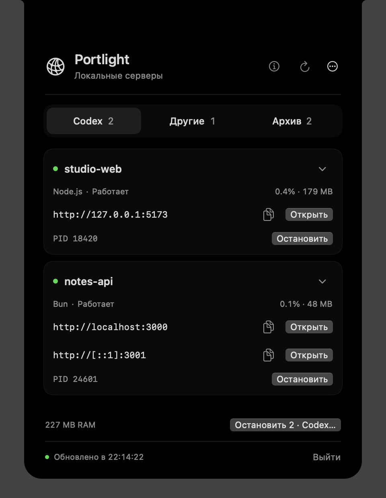

# Portlight

A native macOS utility that turns the MacBook notch into a compact control panel for local development servers. Built with SwiftUI and AppKit. No Dock icon, menu-bar item, Electron, or background daemon.

**Early preview · Apple Silicon · macOS 13+ · Russian interface**



## What it does

- Finds eligible listening TCP servers running on Bun, Python, Node.js, or Deno, rather than listing every runtime process.
- Opens local URLs, shows ports, PID, project folder, CPU and process memory.
- Stops a server or the selected group after confirmation, using **SIGTERM only**.
- Keeps projects in an archive so they can be launched again without opening a terminal.
- Organizes projects into **Codex / Other**. A verified Codex launch is remembered for that project folder across app restarts. A project can also be assigned manually from its card menu.
- Reviews local Git changes, commits selected whole files and pushes reviewed commits to an existing GitHub branch connected to Vercel Production.

Click the notch to expand the panel. Hover shows a soft animated edge without opening it. Escape or a click outside collapses it. The compact panel extends only 6 pt below the physical cutout. The screenshots use fictional sample data; there is no demo mode in the app.

## Install and open

Use the arm64 app ZIP from [Releases](https://github.com/averination/Portlight/releases), unpack it, move **Portlight.app** to Applications and open it. This preview is ad-hoc signed, **not notarized with an Apple Developer certificate**. macOS may block a downloaded copy. Review the source and build locally if you do not wish to allow an unnotarized app. If you trust the downloaded copy, macOS offers an app-specific **Open Anyway** control in System Settings → Privacy & Security. Do not disable Gatekeeper globally.

There is no automatic launch-at-login or updater. Add Portlight to Login Items yourself if desired. On displays without an available notch, reopening the app shows a regular window instead.

**⋯ → Hide Portlight** hides the widget and pauses polling. Open Portlight again in Spotlight or Finder to restore it. **Quit** closes the app; your development servers keep running.

## Build from source

Install Apple's Command Line Tools (`xcode-select --install`) or Xcode, with **Swift 6.0+**. No third-party package dependencies are required. Node/Bun/Python/Deno are only needed to run your own projects.

```sh
./scripts/build-app.sh
open build/Portlight.app
```

The script builds an arm64 release and ad-hoc signs the app. Open `Package.swift` in Xcode to browse and edit the package; use the script for a complete accessory `.app` bundle. macOS 13 is the deployment target; the currently verified system is macOS 15 on Apple Silicon.

```sh
./scripts/check.sh          # logic, persistence and local Git tests
./scripts/check.sh --live   # also starts and stops disposable local test servers
```

The live suite needs Python 3. Node.js is needed for the Node/launcher cases. It does not select existing user servers as stop targets. See [TESTING.md](TESTING.md).

## Codex groups and launch provenance

A **project group** is a saved organizational choice, not proof of where a running process came from. In a running card, use the folder/gear menu; in the archive, use **⋯ → Project group**. Choose Automatic, Codex, or Other. The choice applies to that canonical project folder, including subsequent launches from the archive.

Automatic mode remembers a Codex connection only after observing a valid parent chain to a running, signed OpenAI Codex process. If a server detached before the first observation, its origin may be unavailable; assign the project manually once. Folder names, arbitrary command text and saved group choices never verify a process's origin. A manual Other choice takes precedence over automatic history.

When the source of a running process is unverified, stopping it still requires checking the displayed project and acknowledging the unknown source, even if the project is grouped under Codex.

## Stop scope and permissions

Discovery is limited to the current user's eligible local/wildcard TCP listeners on ports 1024 and above, with project/dev-server evidence. System/protected paths, MCP/LSP infrastructure and debugger listeners are filtered out. This is intentionally conservative, so some custom servers may not appear.

One card represents one PID, possibly with multiple ports. Before sending SIGTERM, Portlight checks the selected process's owner, start time, executable, working folder, endpoints and current group again. Newly discovered or restarted processes are never added to a confirmed batch. It does not stop entire process groups, parent shells, or unrelated runtime processes. There is no force kill. A supervisor may restart a stopped listener; an ignored SIGTERM is reported without escalation.

Polling runs every 3 seconds while expanded and every 12 seconds in the background, and pauses during sleep or when hidden. CPU 100% means one core; memory is per process, not an entire project tree.

No administrator, Accessibility, Screen Recording, or Full Disk Access permission is required for normal use. macOS may request access to a selected project folder. Add the folder explicitly if access is denied. Process inspection can be restricted when launched from another sandbox; run the built `.app` directly as your ordinary user, without sudo.

## GitHub → Vercel publication

Choose **Publish…** from a running server or archive card. Review changes and select files, enter a commit message, then create a **local** commit. Selected files are committed in full; pre-existing unrelated staging is preserved. Commit does not push.

Confirm the existing Production branch connection to Vercel, prepare publication, review **all outgoing commits** and changed files, then confirm the push. Portlight never creates a hosting project, switches branches, merges, rebases or force-pushes. It requires an exact repository root, a single GitHub remote with matching fetch/push URLs, and your Mac's existing Git authentication. Interactive terminal prompts are disabled; configure access in your Git client first. Project hooks, filters and commit signing remain active.

Vercel performs deployment through its existing Git integration. Push completion and deployment completion are separate states. The app can inspect public GitHub production-deployment metadata for the exact pushed SHA and Vercel bot. Private repositories or unavailable metadata require checking the Vercel dashboard manually; an unconfirmed build is never shown as a successful deployment.

Common credential filenames are blocked from selection, but this is **not a secret scanner** and does not inspect old commits. Review outgoing changes yourself. Git timeouts have no automatic retry; verify the repository state before reopening the publication window.

## Local data and network

Project folders, bookmarks, launch recipes, group choices and publication settings are stored in `~/Library/Application Support/Portlight`. Launch receipts and logs are local. No analytics or telemetry is included. There is no built-in browser or recording sandbox.

Discovery is local. Publication explicitly invokes Git networking to your chosen GitHub remote and reads public deployment status from GitHub. Opening a site or the Vercel dashboard uses your browser. Portlight does not request or store GitHub/Vercel API tokens.

## Feedback

This is an early preview. Please report macOS version, Mac model, runtime/framework and the steps to reproduce. Before posting screenshots or diagnostics, remove personal paths, repository URLs, usernames and log contents. The `--diagnose` command prints real process/project metadata; its output is not automatically anonymized.

See [CHANGELOG.md](CHANGELOG.md), [TESTING.md](TESTING.md), and [CONTRIBUTING.md](CONTRIBUTING.md).

## License

[MIT](LICENSE) · Copyright 2026 averination.
